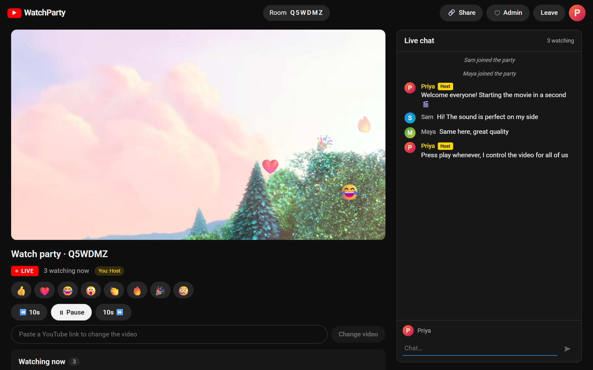
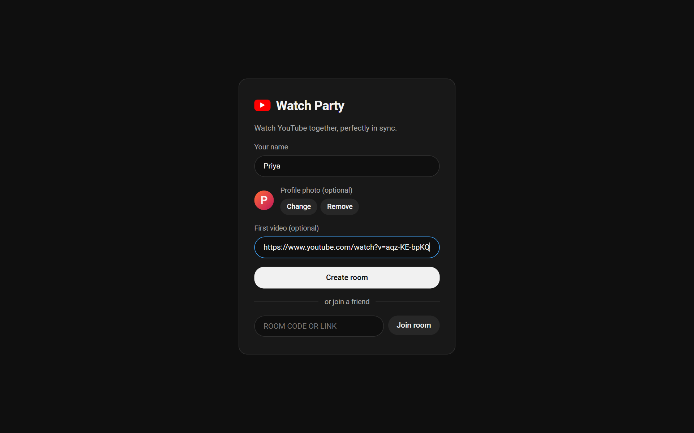
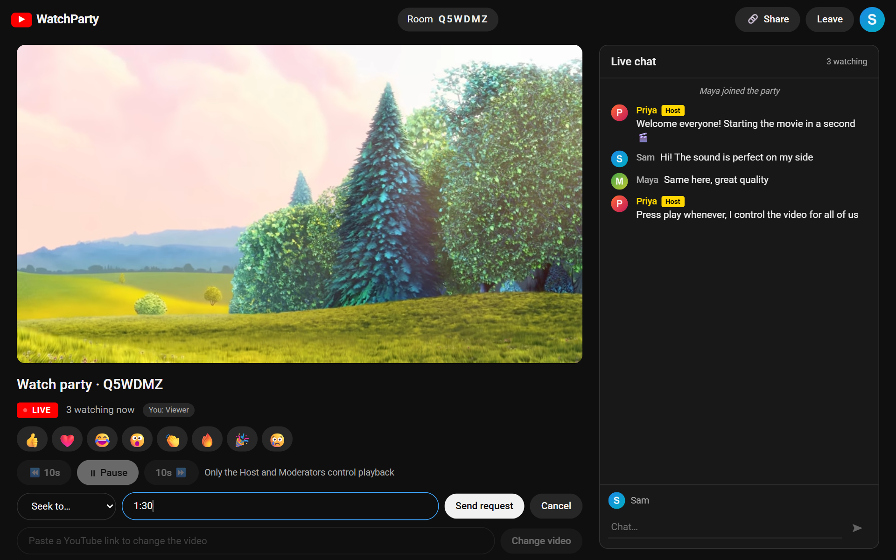
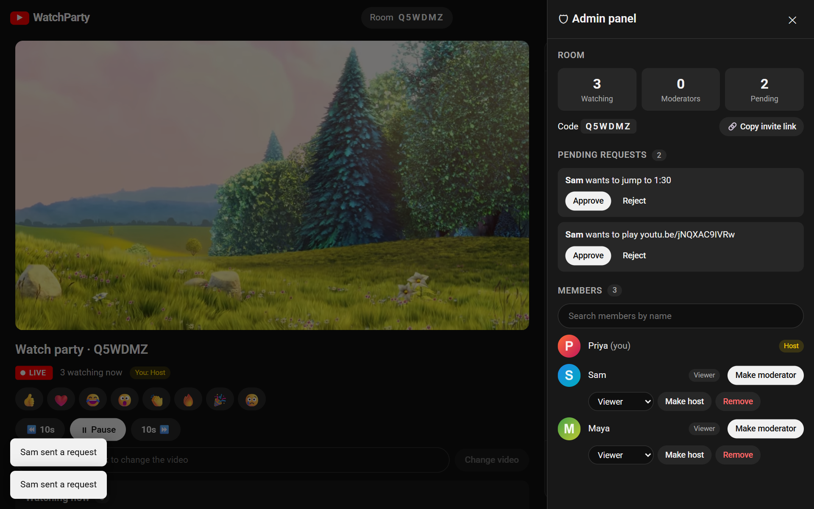
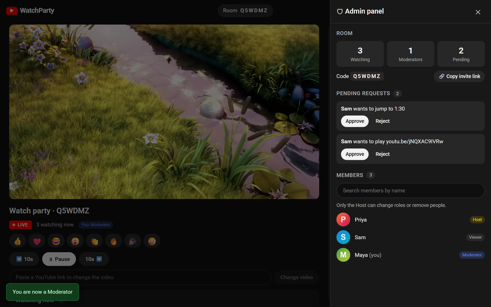
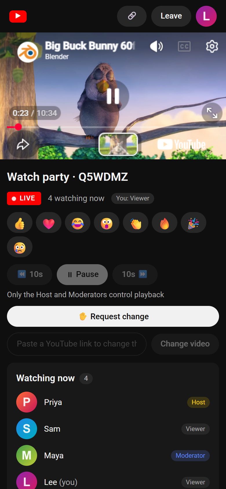
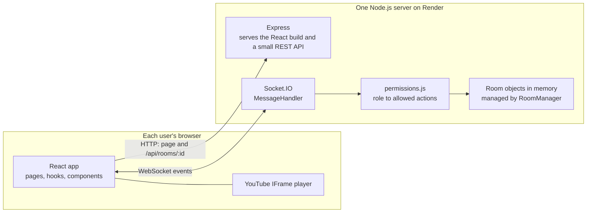
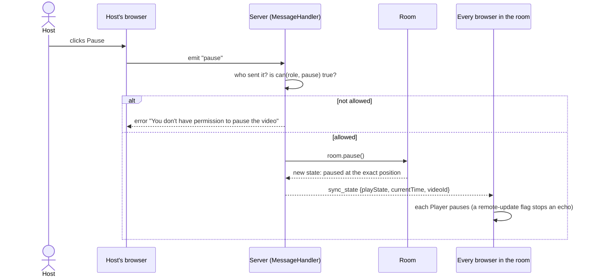
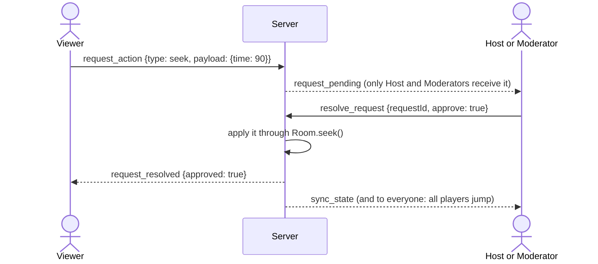

<div align="center">

# 🎬 YouTube Watch Party

**Watch YouTube together, perfectly in sync.**
Create a room, share the link, and everyone sees the same video at the same second, with roles, requests, live chat and emoji reactions.

[](https://youtube-watch-party-dloc.onrender.com)


<br>



<sub>The Host's view while three people watch together. Video: *Big Buck Bunny* © Blender Foundation (CC BY 3.0).</sub>

</div>

**Live URL:** https://youtube-watch-party-dloc.onrender.com
*(The free Render plan sleeps when idle, so the very first visit can take up to a minute to wake the server.)*

---

## Table of contents

1. [What this project is](#1-what-this-project-is)
2. [A tour of the app](#2-a-tour-of-the-app)
3. [Features](#3-features)
4. [How it works](#4-how-it-works)
5. [Roles and permissions](#5-roles-and-permissions)
6. [My thinking process: decisions and trade-offs](#6-my-thinking-process-decisions-and-trade-offs)
7. [Problems I hit and how I fixed them](#7-problems-i-hit-and-how-i-fixed-them)
8. [Tech stack](#8-tech-stack)
9. [Project structure](#9-project-structure)
10. [Run it locally](#10-run-it-locally)
11. [Testing](#11-testing)
12. [Deploy to Render](#12-deploy-to-render)
13. [API reference](#13-api-reference)
14. [Assignment checklist](#14-assignment-checklist)
15. [Limitations and future work](#15-limitations-and-future-work)

---

## 1. What this project is

A **Watch Party** lets several people watch the same YouTube video together, even from different places. When one person pauses, seeks or changes the video, everybody else's player does exactly the same within a moment. Someone who joins late immediately lands on the right video at the right second.

The interesting part is not playing a video; it is **keeping many browsers consistent** while deciding **who is allowed to control them**. So the project is built around two ideas:

1. **The server owns the truth.** Browsers never decide what the video is doing. They *ask*, the server checks, updates one authoritative state, and tells everyone.
2. **Permissions are checked on the server, always.** The interface hides buttons people can't use, but that is only politeness. If someone sends a forbidden event by hand, the server refuses it.

---

## 2. A tour of the app

### Create or join a room

Enter a name, optionally add a profile photo and a first video, and create a room. Or paste a room code or a full invite link to join a friend.



### The Host's room

The Host controls playback and can paste any YouTube link to change the video. Everyone can send emoji reactions that float over every player, and chat live. The sidebar shows who is watching, with Host/Mod tags.


### A Viewer's room: watch-only, but they can ask

Viewers see disabled playback controls and the player ignores their clicks. Instead they use **Request change**: ask to play, pause, jump to a time or switch to a new video.



### The Admin panel (Host)

Pending requests with **Approve / Reject**, room stats, an invite link, and a member list with search. Next to each person the Host sees **Make moderator**, a role dropdown, **Make host** and **Remove**.



### The Moderator's view

A Moderator can resolve requests and control playback, but the panel clearly says that only the Host can change roles or remove people, and those buttons are not shown.



### On a phone

The layout is responsive: the player goes full width and the chat and lists stack underneath.

<p align="center"></p>

---

## 3. Features

**Rooms and sync**
- Create a room (you become the Host) and share a 6-character code or a link like `/room/ABC123`.
- Play, pause, seek and **change video** are mirrored to everyone in real time.
- **Late joiners** get the current video and position immediately.
- **Drift correction:** if a player is more than 1.5 s away from the server's position, it jumps back.
- Optional **first video** when creating a room. A new room has no video until one is chosen.

**Roles and control**
- Three roles: **Host**, **Moderator**, **Viewer** (see [section 5](#5-roles-and-permissions)).
- **Request and approval flow:** Viewers ask for a change; a Host or Moderator approves or rejects. The change is applied only on approval, and the Viewer is told the result.
- **Admin panel** for Host and Moderators with live request badge, stats, member **search**, and Host-only role and removal controls.
- **Host handover:** transfer the Host role, or, if the Host leaves or disconnects, the next person is promoted automatically (a Moderator first, otherwise the earliest joiner). An empty room is deleted.

**Social**
- **Live chat** with Host/Mod tags and "joined / left / is now a Moderator" lines.
- **Emoji reactions** (👍 ❤️ 😂 😮 👏 🔥 🎉 😢) floating over everyone's player.
- Optional **profile photos**, resized in the browser and shown everywhere.
- Live viewer count.

**Reliability and polish**
- **Refresh-safe:** reloading the page keeps your seat, role and chat history (30-second reconnect grace period).
- Clear errors as toasts; a removed user sees a message and is sent home and cannot rejoin.
- YouTube-style dark theme, responsive on phones.

---

## 4. How it works

### The big picture



Everything real-time travels over a WebSocket. Express only serves the built React files and a few tiny HTTP endpoints. Because both live on **one server and one URL**, there is no CORS to configure.

### Example: the Host clicks Pause



In the code that is: `Controls.jsx` → `RoomPage.jsx` (`socket.emit('pause')`) → `MessageHandler.js` (`bind` → `can()` → `Room.pause()` → `broadcastState`) → `useRoom.js` (`onSyncState`) → `Player.jsx` (`applyServerState`).

### Keeping everyone on the same second

- The server stores `{ videoId, playState, currentTime, updatedAt }`, where `currentTime` is the position **at `updatedAt`**.
- It never stores a ticking clock. When asked, `Room.getCurrentState()` computes `currentTime + (now - updatedAt)` while playing, and plain `currentTime` while paused. This is also how **late joiners** land on the right second.
- Each browser applies updates with `Player.jsx`: it loads a new video, seeks if it is more than 0.5 s off, then plays or pauses.
- **Stopping an echo loop.** When the server says "pause" and the player obeys, the YouTube player fires its own "paused" event, which would be sent back to the server and broadcast again, forever. A **remote-update flag** is raised while the page drives the player, so those callbacks are ignored. A second check only reports play/pause changes that actually differ from what the server already believes.
- **Detecting seeks.** YouTube has no "seeked" event, so a timer (every 500 ms) compares the real position with where it should be; a jump of more than 1.5 s by a Host or Moderator is reported as `seek`.
- **Drift correction** runs on the same timer for everybody.
- **Autoplay blocked?** Browsers sometimes refuse to start video without a click. If the server says "playing" but the local player sits idle for 2 s, a "Click to start playback" button appears.

### The request and approval flow



If two moderators click at the same moment, the first one wins and the second gets "already handled". If the requester leaves, their requests are dropped.

---

## 5. Roles and permissions

| Action | Host | Moderator | Viewer |
| --- | :---: | :---: | :---: |
| Play / pause / seek | ✅ | ✅ | ❌ (can request) |
| Change video | ✅ | ✅ | ❌ (can request) |
| Approve / reject requests | ✅ | ✅ | ❌ |
| Send a request | acts directly | acts directly | ✅ |
| Make or remove a Moderator | ✅ | ❌ | ❌ |
| Remove people from the room | ✅ | ❌ | ❌ |
| Transfer the Host role | ✅ | ❌ | ❌ |
| Chat, reactions, own profile photo | ✅ | ✅ | ✅ |

- **Host** is assigned automatically to whoever creates the room. **Moderator** is given only by the Host. **Everyone else is a Viewer**; nobody is a Moderator until the Host says so.
- The whole table lives in one file, [`server/src/permissions.js`](server/src/permissions.js). Every socket event goes through a single gate (`MessageHandler.bind`) that checks it **before** the handler runs, so a handler can never forget the check.
- The brief says Moderators *may optionally* manage roles. I kept those Host-only, which keeps the rule "Host-only actions can never be performed by anyone else" simple.

---

## 6. My thinking process: decisions and trade-offs

Here is how I approached the build, and the reasoning behind the choices that mattered.

**Build order.** I read the brief, wrote down the one rule everything depends on (*the server owns the truth*), and built the **server first**, with automated tests, before touching the interface. If the rules are right and tested, the UI is just a view of them. Then the client (player and sync), then the request flow, chat and polish, then docs and deployment.

| Decision | Why I chose it | Trade-off |
| --- | --- | --- |
| **Server-authoritative state** | Clients can't be trusted; one source of truth means everyone converges on the same state. | A small round trip before your own action shows up. |
| **Socket.IO instead of plain `ws`** | Rooms, named events, acknowledgement callbacks, automatic reconnection, and a polling fallback are built in. With plain `ws` I would have rebuilt all of that. | Larger client library; only Socket.IO clients can talk to it. |
| **One permission map + one gate** | A single table (`permissions.js`) and a single wrapper (`bind`) make it impossible to add an event and forget the check. | Slightly more indirection when reading the code. |
| **Separate classes for state, validation and events** | `Room` (state), `RoomManager` (lifecycle), `MessageHandler` (events), `validators.js` (input checks). Each can be understood and tested alone. | More files than one big handler. |
| **In-memory storage, no database** | The brief marks a database optional. It is the simplest thing that fully works, and every room is short-lived anyway. | Restarting or redeploying the server ends all rooms. |
| **Identity = a per-tab session id**, not the socket id | A page refresh creates a new socket. A stable id lets the server recognise "the same person" and give their seat and role back. | No real accounts; a removed user could return by clearing their tab storage. |
| **30-second reconnect grace period** | A refresh, a phone switching apps or a sleeping tab drops the socket for a moment. Without a delay the Host would lose the Host role every time. | A user who really left stays listed for 30 seconds. |
| **Computed position instead of a ticking clock** | `currentTime + elapsed` is exact, needs no timers on the server, and handles late joiners for free. | Assumes one video timeline. |
| **Validation on every payload** | Anyone can open the console and emit events. Names, codes, video ids, times, roles, chat text, emojis and images are all checked. | A bit of repetition. |
| **Fixed emoji list for reactions** | A client can't push arbitrary text through the reaction channel. A 250 ms per-user limit stops flooding. | Only 8 emojis. |
| **Profile photos shrunk in the browser, served by URL** | The browser crops to 128 px (a few KB). The server accepts only real JPEGs (it checks the file signature, not the label) up to 60 KB. Events carry a small URL, not the image, so lists stay light. | Images live in memory and vanish on restart. |
| **One deployable service** | Express serves the built React files and the sockets on one port: one URL, same origin, no CORS. | The frontend and backend can't scale independently. |
| **Plain JavaScript, not TypeScript** | The brief lists TypeScript only as an example stack. I wanted to be able to explain every line, and the server needs no build step. | No compile-time type checks; data shapes are documented in comments and the API table below. |
| **No live-stream support** | Not in the brief, and the embedded player gives no reliable position for live streams (viewers ended up hours apart in my tests), so I removed it instead of shipping something flaky. | A live link plays but its position is not synced. |

---

## 7. Problems I hit and how I fixed them

| Problem | Cause | Fix |
| --- | --- | --- |
| Pause/play kept bouncing between clients | Obeying the server made the player fire its own event, which was sent back (an **echo loop**) | A remote-update flag, plus only reporting changes that differ from the server's state |
| Dragging the timeline briefly paused everyone | YouTube reports "paused" for a moment while you scrub | Wait 300 ms and only report a pause if the player is still paused |
| Creating a room deleted it | The home page created the room by joining, then the room page joined again; the server treated the second join as "leave the old room first", the Host left and the empty room was deleted | A second join of the same room and session on the same socket counts as a reconnect, not a leave |
| Rooms vanished in development | React StrictMode mounts, unmounts and remounts effects; leaving a room on unmount removed the user before the re-join | Leaving is explicit (the Leave button); closing a tab is handled by disconnect plus the grace period |
| Build worked locally, failed on Render | Render sets `NODE_ENV=production`, so `npm install` skips devDependencies, and Vite is one | The install scripts use `npm install --include=dev` |
| A stray `file:..` dependency appeared | Running `npm --prefix server install` from the repo root made npm add the root package as a dependency | The install script now `cd`s into each folder |
| `npm install` then `npm run dev` didn't work on a fresh clone | The root install only installed the root package | A root `postinstall` step installs server and client too |
| A joining viewer's video didn't start | Browsers block autoplay without a click | A "Click to start playback" button appears when the player sits idle |
| Live streams drifted hours apart | Players report positions in their own windows, not a shared timeline | Removed live-stream support (see above) |
| Everyone's page suddenly showed "Room not found" and the room was gone | The server restarted (a Render redeploy after a `git push` does this). Rooms live in memory, so a restart clears all of them | A clear "This room has ended" screen with a button to start a new room, a safety net so one unexpected error can't crash the server, and a longer reconnect grace period. Auto-Deploy can be switched off in Render before a demo |
| The first reaction emoji was clipped on a phone | The reaction row had no side margin in the mobile layout | Added the missing margin (found while taking the screenshots above) |
| Wording mismatch ("Participant" vs "Viewer") and no chat line when someone was removed | Found during the final test run | One label everywhere; a "was removed" line in chat |
| After converting from TypeScript to JavaScript the server wouldn't start | ES modules need file extensions on imports and have no `__dirname` | Imports end in `.js`; `__dirname` is built from `import.meta.url` |

---

## 8. Tech stack

| Layer | Technology | Why |
| --- | --- | --- |
| Frontend | **React 18** + **Vite** (plain JavaScript), React Router | Components, a hook (`useRoom`) that turns socket events into state, fast builds |
| Backend | **Node.js** + **Express** | Serves the app and a few HTTP endpoints |
| Real-time | **Socket.IO** (WebSockets) | Rooms, named events, acks, reconnection |
| Video | **YouTube IFrame Player API** | The official way to control an embedded player |
| Storage | In memory | Optional per the brief; simplest thing that works |
| Hosting | **Render** (one web service, free plan) | WebSocket-friendly, deploys straight from GitHub |
| Tests | Node scripts + `socket.io-client` | Real sockets against a real server |

---

## 9. Project structure

```
.
├── package.json              root scripts: dev, build, start
├── render.yaml               Render blueprint (build and start commands, health check)
├── README.md
├── docs/screenshots/         images used in this README
├── server/
│   ├── src/
│   │   ├── index.js            Express app, REST endpoints, static files, starts Socket.IO
│   │   ├── MessageHandler.js   every socket event: who sent it -> permission check -> Room -> emit
│   │   ├── Room.js             one room's state: participants, video, requests, chat
│   │   ├── RoomManager.js      creates, finds and deletes rooms; short room codes; cleanup
│   │   ├── Participant.js      one person (id, username, role, socketId, avatar)
│   │   ├── permissions.js      the role -> allowed actions table
│   │   ├── validators.js       input checks for every payload
│   │   └── errors.js           errors that are safe to show to users
│   └── test/                 automated socket tests (helpers + 4 suites)
└── client/
    ├── vite.config.js        dev proxy to the server
    └── src/
        ├── pages/            Home.jsx, RoomPage.jsx
        ├── hooks/useRoom.js  joins a room and turns socket events into React state
        ├── socket.js         the shared Socket.IO connection and session id
        ├── components/       Player, Controls, Chat, AdminPanel, Participants, ReactionBar, ...
        └── utils/            youtube link parsing, time helpers, image resizing
```

---

## 10. Run it locally

Requires **Node.js 18 or newer**.

```bash
npm install     # installs the root, /server and /client dependencies
npm run dev     # starts the server (port 4000) and the Vite dev server together
```

Open the address Vite prints in the terminal (normally http://localhost:5173; if that port is busy it picks the next free one). Vite forwards `/api` and `/socket.io` to the server, so there is nothing to configure.

Production mode, exactly as Render runs it:

```bash
npm run build   # installs both sets of dependencies and builds the React app
npm start       # serves everything on http://localhost:4000
```

### Environment variables

| Variable | Default | Purpose |
| --- | --- | --- |
| `PORT` | `4000` | Port the server listens on (Render sets it). |
| `CLIENT_DIST` | `client/dist` | Folder with the built frontend. |
| `RECONNECT_GRACE_MS` | `30000` | How long a disconnected user keeps their seat (the tests set it low). |
| `VITE_SERVER_URL` | `http://localhost:4000` | Where the Vite dev proxy sends API and socket traffic. |

No secrets are needed.

### Try it with two windows

1. Window 1: enter a name, optionally paste a YouTube link, **Create room**, then **Share** to copy the link.
2. Window 2 (a private window works): open the link and join with another name.
3. Window 1: play, pause and skip. Window 2 follows and its controls are disabled.
4. Window 2: **Request change**. Window 1: **Admin** to approve or reject.
5. Window 1: in **Admin**, search a member and click **Make moderator**.
6. Either window: click an emoji and send a chat message.

---

## 11. Testing

```bash
cd server
npm test
```

**52 automated tests** start the real server on a free port and drive it with fake Socket.IO clients over WebSockets:

| Suite | Tests | What it covers |
| --- | :---: | --- |
| `phase1.test.js` | 14 | Room creation, Host/Viewer roles, permission errors, sync, late joiners, role assignment, Host handover, bad room codes, duplicate names, empty rooms |
| `phase3.test.js` | 20 | The request and approval flow (approve, reject, double-resolve, limits) and chat (broadcast, validation, history) |
| `phase4.test.js` | 11 | Profile pictures (valid and invalid uploads, serving, versioning) and default roles |
| `phase5.test.js` | 7 | Emoji reactions (all roles, allowed list, rate limit, removed users) |

I also tested the finished app by hand in the browser with a Host, a Moderator and a Viewer: playback sync, requests, admin actions, chat, reactions, photos, refresh, removal, ownership transfer, the Host leaving, and invalid room codes.

---

## 12. Deploy to Render

The whole app is **one Render web service**; [`render.yaml`](render.yaml) holds the settings.

1. Push the project to GitHub.
2. In Render: **New → Blueprint**, choose the repo, and **Apply**.
3. Or create a **Web Service** by hand with:
   - Build command: `npm run build`
   - Start command: `npm start`
   - Health check path: `/healthz`
   - Environment: `NODE_VERSION` = `22` (Render provides `PORT`)
4. Open the `onrender.com` URL once the build says **Live**.

Notes:
- Render redeploys automatically on every push to `main`. A deploy restarts the server, which ends all open rooms.
- **Free plan:** the service sleeps after about 15 minutes with no visitors and takes about a minute to wake. A free uptime monitor that opens `/healthz` every few minutes keeps it awake.

---

## 13. API reference

### Socket events: client to server

| Event | Payload | Who may send it |
| --- | --- | --- |
| `join_room` | `{ roomId?, username, sessionId?, videoId?, avatar? }` (no `roomId` creates a room) | anyone |
| `leave_room` | `{ roomId }` | joined users |
| `play`, `pause` | none | Host, Moderator |
| `seek` | `{ time }` | Host, Moderator |
| `change_video` | `{ videoId }` | Host, Moderator |
| `assign_role` | `{ userId, role }` (`moderator` or `participant`) | Host |
| `remove_participant` | `{ userId }` | Host |
| `transfer_host` | `{ userId }` | Host |
| `request_action` | `{ type, payload }` (`play`, `pause`, `seek`, `change_video`) | Viewer |
| `resolve_request` | `{ requestId, approve }` | Host, Moderator |
| `chat_message` | `{ text }` (max 500 characters) | everyone |
| `send_reaction` | `{ emoji }` (one of 8 allowed) | everyone |
| `update_profile` | `{ avatar }` (JPEG data URL, or `null` to remove) | everyone |

### Socket events: server to clients

`sync_state { playState, currentTime, videoId }` · `user_joined` · `user_left` · `role_assigned` · `participant_removed` · `host_transferred` · `request_pending` · `request_list` · `request_resolved` · `chat_message` · `reaction` · `profile_updated` · `error { message }`

The server broadcasts to everyone in the room, including the sender, so all clients converge on the same state.

### HTTP

| Route | Purpose |
| --- | --- |
| `GET /healthz` | Health check, returns `{ ok, rooms }` |
| `GET /api/rooms/:id` | Does this room exist? (used before asking for a name) |
| `GET /api/rooms/:id/avatar/:userId` | A participant's profile picture |

---

## 14. Assignment checklist

How this project maps to the brief:

| Requirement from the brief | Done | Where |
| --- | :---: | --- |
| Real-time sync of play/pause, seek and current video | ✅ | `Room.js`, `Player.jsx` |
| Room-based model with unique codes and links | ✅ | `RoomManager.js`, `/room/:id` |
| YouTube integration | ✅ | `Player.jsx` (IFrame API) |
| WebSockets for real-time communication | ✅ | Socket.IO in `MessageHandler.js` |
| Role-based access (Host assigns roles) | ✅ | `permissions.js`, Admin panel |
| Backend validates permissions before processing events | ✅ | `MessageHandler.bind` |
| Role updates broadcast so the UI can disable controls | ✅ | `role_assigned`, `useRoom.js` |
| Host: assign roles, remove participants, transfer host | ✅ | Admin panel |
| Participants must request approval for changes | ✅ | `request_action` / `resolve_request` |
| Participant list with roles | ✅ | Sidebar and Admin panel |
| Chat *(optional)* | ✅ | `Chat.jsx` |
| OOP structure *(bonus)* | ✅ | `Room`, `Participant`, `RoomManager`, `MessageHandler` |
| Emoji reactions *(bonus)* | ✅ | `ReactionBar.jsx`, `send_reaction` |
| Transfer host *(bonus)* | ✅ | Admin panel |
| Deployed publicly, URL in README | ✅ | Render, link at the top |
| README with setup and architecture | ✅ | this file |
| Code walkthrough readiness | ✅ | Sections 4 to 7 of this README |
| Scalability, persistent rooms, authentication *(bonus)* | ❌ | not built; see [section 15](#15-limitations-and-future-work) for how I would add them |

---

## 15. Limitations and future work

**Known limitations**
- **In-memory only:** a restart or redeploy ends all rooms, and the free Render plan sleeps when idle.
- **Single server instance;** I did not load-test it, so I can't claim a user count.
- **No accounts:** identity is per browser tab, so a removed person could return by clearing their tab storage.
- **Live streams** are not position-synced.
- Videos whose owner disabled embedding can't play inside any website (a YouTube rule).
- Browsers may block autoplay for a joining viewer; a button appears in that case.

**What I would do with more time**
- Move room state to **Redis or a database** so rooms survive restarts, and add the **Socket.IO Redis adapter** with sticky sessions to run several instances.
- Real **authentication**, so roles and removals belong to people, not tabs.
- **Rate limiting** and a maximum room size.
- A **load test** to find a real user and room limit.
- Browser **end-to-end tests** for the player logic, not only socket tests.
- A playlist or queue and per-room settings.

---

<div align="center">

Built as a full-stack internship assignment.

</div>
